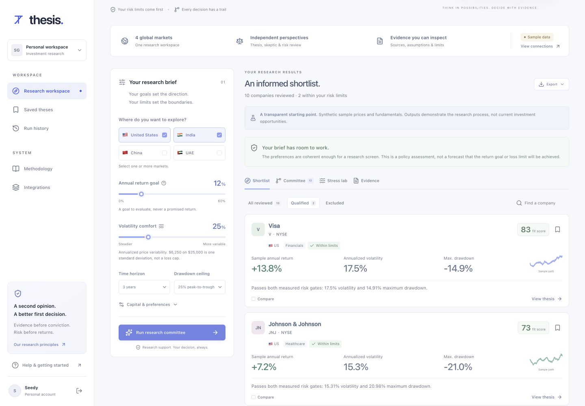

# Thesis

**Conviction, with a counterargument.**

A global stock research committee that checks your risk limits, challenges the thesis, explains rejected candidates and can decline to make a pick.

Built by **Shivam Gupta**, with AI-assisted engineering, for **Open Agent Hackathon 2026**. Primary track: **The Agent That Can Explain Why**.



## What you can do

- Select US, India, China and UAE research universes, an annual return aspiration, annualized-volatility comfort, drawdown tolerance, horizon, capital and reporting currency.
- Run a typed committee: planner, data steward, quantitative analyst, fundamental analyst, skeptic, risk guardian, evaluator and memory.
- Inspect actual critique/revision branches and hard exclusions. A high fit score never bypasses a risk gate.
- Compare up to three companies, inspect bull and bear cases, review stress assumptions and follow the source register.
- Save a thesis with an invalidation condition, edit notes, reopen prior research, and export a print-ready dossier or JSON.
- Recall prior decisions through the **official Meterless H-MEM engine**, while recalculating current risk from prices.
- Use connected research with **Zetaris** as the financial-source data layer and **Meterless Nightshift** as the primary and sole connected AI provider.

There is no trade execution, brokerage connection or promise of future returns. This is research support, not an audited investment advisory service.

## Start from a clean checkout

Requirements: Node.js 22.13+ and npm. No sponsor credentials are needed for sample mode.

```bash
npm ci
npm run setup
npm run dev
```

Open the **Local URL printed by the server**. Choose **Sign in**. The portable development server simulates a single synthetic local account, `seedy@sites.test`. It strips caller-supplied identity headers. Hosted sign-in belongs to the Sites platform, and the development shim is absent from production builds.

If another project uses the default port:

```bash
npm run dev -- --port 5188
```

`npm run setup` builds the Worker and applies each checked-in local D1 migration once, tracking applied file hashes in ignored local state. Subsequent runs skip unchanged migrations. Local and hosted databases are separate.

## A reproducible judge walkthrough

1. Keep the default US + India mandate: 12% return aspiration, 25% volatility, 25% historical drawdown, 36 months.
2. Run the committee. In this synthetic fixture, two companies pass. Inspect Visa's countercase and invalidation conditions.
3. View excluded cases. NVIDIA's illustrative high growth does not override its measured risk breaches.
4. Open **Committee** and inspect the real rule transitions and H-MEM recall event. Sample deterministic roles identify their rule model rather than pretending an LLM ran.
5. Save a thesis, add a note, compare companies and export the research record.
6. Change the aspiration to 40%, volatility to 10%, drawdown to 10%. The committee abstains and makes no model request.
7. Enable **Connected** under **Capital & preferences** only after configuring and verifying the sponsor services.

All 20 sample companies use **synthetic price paths, financial inputs and catalysts**. The fixture clock is fixed for repeatable judging. Real-company investor-relations links are discovery references; they do not substantiate the synthetic numbers. This build does not establish investment performance.

## Why this is an agent system

The computational specialists perform separate work over shared typed state. The skeptic produces revision tasks. The planner applies those tasks to scores and statuses, and the risk guardian independently vetoes breaches. Tests demonstrate a skeptic changing the initial winning rank. Contradictory preferences branch to abstention instead of loosening the mandate.

Connected mode adds an independent Nightshift qualitative critique. The evaluator checks candidate identities, citation membership, required source kinds, output schema and prohibited numerical/forecast claims. A rejected response gets one repair attempt. These controls do not establish semantic truth: model prose remains an unverified interpretation for human review. Failed generations retain their model receipts and usage accounting.

H-MEM stores and retrieves account-scoped historical decisions with source provenance. Older context rotates out of the bounded active snapshot; audit entries move into separate D1 archives before rotation. Deleting a run clears aggregate memory and archives so deleted context cannot reappear through recall. Remaining run history can rebuild context on the next request.

See [architecture](docs/architecture.md) and [research/data contract](docs/data-contract.md).

## Sponsor integration status

| Technology | Working role | Evidence boundary |
| --- | --- | --- |
| Meterless H-MEM | Official pinned TypeScript engine, actual hybrid recall and decision memory | Automated feature tests and upstream conformance tests run without credentials |
| Meterless Nightshift | Source-constrained skeptical research review | A fresh real Qwen review with concrete model and runtime receipt is retained in [proof](evidence/nightshift-live.json) |
| Zetaris | Federates price, fundamental and filing-provenance sources into `thesis.research_universe` | Adapter, three source files, registration SQL, contract tests and seeding verifier are included; only a retained successful instance proof establishes live execution |
| NVIDIA Nemotron | Optional concrete model through Nightshift | Not qualified merely because a model is listed or downloaded. Claim working use only after a successful feature receipt |

Configuration is not verification. A real sponsor request over synthetic records remains a **sample-data demonstration**. Connected source failures do not silently turn into a successful live result.

### Configure connected research

```bash
cp .env.example .dev.vars
```

Replace placeholders locally, or set environment variables through your hosting service. Never commit secrets. Put NVIDIA keys in Nightshift's Providers settings, not in Thesis.

Read [sponsor setup](docs/sponsor-setup.md). Run the fixture exporter and seed a licensed Zetaris instance:

```bash
npm run fixtures:export
npx tsx scripts/sponsor-seed.ts
npm run sponsor:proof
```

The seed script performs explicit setup mutations against the configured instance. Review the configuration and [SQL](data/zetaris/register.sql) first. The app itself only issues bounded read-only queries against an allowlisted configured view.

A hosted Worker cannot reach laptop loopback. For a local sponsor demonstration run Thesis locally, or configure reachable authenticated sponsor endpoints. The hosted sample application needs no external credentials.

## Verification

```bash
npm run typecheck
npm test
npm run build
```

For API integration tests against the local development server:

```bash
THESIS_TEST_URL=http://127.0.0.1:5188 npm run test:api
```

The script uses the synthetic local account, creates identified test records and removes those records afterward. Do not run it against a real user workspace. Tests cover authentication, cross-origin mutation refusal, validated research, idempotency, saved-record identity, note persistence, reports and abstention.

For multi-account isolation checks, run the **built Worker locally** with `npm start -- --port 5190`, then use `THESIS_TEST_URL=http://127.0.0.1:5190 THESIS_TEST_TRUSTED_HEADERS=1 npm run test:api`. This test supplies synthetic platform identity headers. Never expose that raw local Worker publicly without the hosting authentication boundary.

## Deployment

The tracked `.openai/hosting.json` declares Site identity and the D1 binding. The Sites publishing workflow applies generated Drizzle migrations before deploying the Worker. Source includes the generated SQL and migration metadata. The production site defaults to owner-private access with platform sign-in.

The repository includes CI for clean installation, TypeScript, tests and a production build. See [SECURITY.md](SECURITY.md) for the identity trust boundary and [launch-readiness](docs/launch-readiness.md) for remaining commercial prerequisites.

## Product and economics

The initial commercial hypothesis is a $19/month research workspace for self-directed investors, with bounded model use and saved decision dossiers. This is proposed pricing, not validated demand or revenue. Data licensing, market access, jurisdiction-specific obligations and customer willingness to pay require validation. See [product thesis](docs/product-strategy.md).

## Acknowledgments and pre-existing components

New Thesis product code was authored during this build. Pre-existing open-source components include the Vinext/Sites starter, React, Cloudflare tooling, Drizzle, Zod, Lucide and Meterless H-MEM. Sponsor API knowledge and an existing local Nightshift installation were reused from earlier setup work. The application does not reuse another product's business logic or claim its test receipts as Thesis evidence.

Project source is MIT licensed. Vendored H-MEM retains Apache-2.0, its pinned commit and attribution. Other components retain their licenses.
