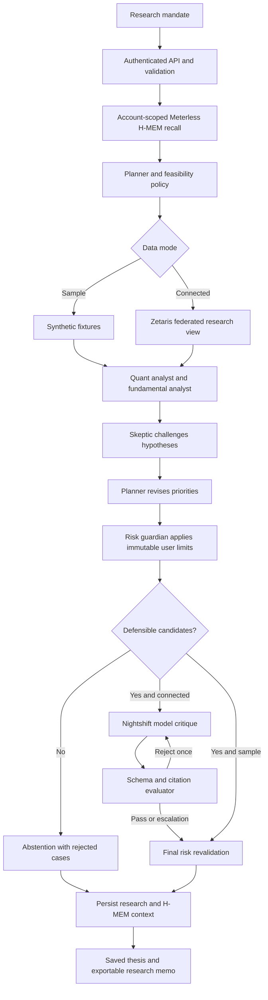

# Architecture and trust boundaries

Thesis uses a custom typed research state machine rather than a chat transcript. Computational specialists own quantification and hard gates. Meterless Nightshift supplies a source-constrained skeptical review in connected mode. The evaluator rejects unsupported entity references or evidence IDs and can ask for one bounded repair.

## Runtime

- React 19, TypeScript, Vinext and Vite power the interface and route handlers.
- Cloudflare Workers hosts server-side code. D1 holds account-scoped runs, saved theses, rate counters and H-MEM snapshots.
- ChatGPT sign-in establishes the platform visitor identity. Server routes authorize every saved record by the stable user ID.
- The repository's portable local preview emulates sign-in on loopback only. Hosted authentication belongs to the platform, not the application bundle.
- Sponsor credentials exist only in server environment variables. The browser never chooses a data URL, SQL fragment or model endpoint.

## Data and evidence

Prices, reported fundamentals and source evidence enter through explicit data contracts. Sample values are synthetic and all provenance records carry `sample:true`. Company investor-relations links in sample mode are reference destinations and do not support the synthetic numbers.

A connected Zetaris query validates returned identities, scalar ranges, daily closing prices, evidence kinds and source metadata. A real data-layer connection serving fixtures still yields a sample-data report. Live financial evidence must pass freshness and provenance checks. The application recalculates risk from the price series instead of trusting summary fields.

Source passages are untrusted. Prompts tell the model to use them as data. Output must refer to a candidate and that candidate's actual evidence IDs. These checks reject invented references but cannot prove a cited claim is true. Human source verification remains necessary.

## State and recovery

Each signed-in request gets a durable run ID before research starts. An optional idempotency key prevents duplicate completed runs; reuse with changed inputs returns a conflict. Provider failure leaves a failed or explicitly degraded outcome rather than a successful live claim. Research history retrieves completed records. A running request interrupted by process termination can remain unfinished and requires a new request; this is a current limitation rather than a full durable-job queue.

The UI does not create fake model-completion events while waiting. It renders the actual returned audit trail. Deterministic roles identify their rule model; model requests identify returned provider models and request receipts. H-MEM retains previous decisions per account and does not replace fresh evidence.

## Safety properties

- A narrative model never changes computed volatility, drawdown or gate limits.
- A conflict or unsuitable short horizon can cause abstention.
- Requests have bounded body size, a strict preference schema and same-origin mutation checks.
- Writes require sign-in. Every read, update and delete of personal records includes the current user ID.
- Research is rate-limited. Model payloads and repair loops have bounded size and count.
- JSON and HTML exports escape untrusted text. HTTP errors do not reveal secrets or raw provider bodies.
- No broker connection, trade execution, allocation optimization, guaranteed return or automated investment action exists.

## Known operational limits

D1 provides durable application storage; it does not satisfy the hackathon's Zetaris data-layer requirement by itself. Zetaris is required for connected financial-source research. Laptop loopback sponsor services are unavailable to a hosted Worker. Deploy reachable authenticated services or use the local connected demonstration.

The current security controls are implementation safeguards, not a penetration-test certification. Retention, backups, monitoring, load testing, market-data redistribution rights and jurisdiction-specific compliance must be validated before commercial launch.
