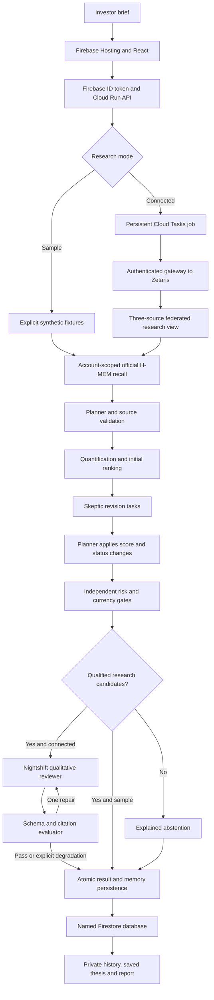

# Architecture and trust boundaries

Primary track: **Reasoning Architecture**. Thesis combines typed decision state,
computational specialists, persistent memory and bounded model interpretation.
The public application is [thesis-investing.web.app](https://thesis-investing.web.app).

## Public and alternate runtimes

Firebase Hosting serves the Vite/React web build and rewrites `/api/**` to a
stateless Node 24 Cloud Run service. Firebase anonymous authentication supplies a
real browser-owned private workspace without an email signup step. The server
verifies ID tokens before authorizing personal records. A hash of the verified
UID partitions records in a dedicated named Firestore database.

The Node build reuses the existing research, provider, report and API validation
code. Build-time aliases replace only the Sites identity helper, D1 repository
and Cloudflare environment binding. The alternate Sites/Vinext deployment still
uses platform identity and D1. A raw Worker that trusts arbitrary Sites identity
headers must never be exposed directly to the Internet. The public Node API
explicitly rejects that trust model.

Firestore stores completed decisions, saved theses, notes, rate counters, current
H-MEM context and rotated audit archives. Results are compressed and bounded.
Recent history uses small completion-index records; full exports paginate reads
and apply Node stream backpressure. No production account persistence depends on
a Cloud Run container filesystem or ephemeral SQLite.

## Research state and reasoning

The planner compiles an explicit mandate. Data validation checks source identity,
provenance, scalar ranges, snapshot dates and price-series consistency. The quant
specialist recomputes annualized return, volatility and peak-to-trough drawdown.
The initial ranking is stored in shared state before critique.

The deterministic skeptic produces revision tasks for valuation, earnings,
financing, horizon and currency concerns. The planner applies actual score/status
changes and re-ranks. The risk guardian then applies unrounded hard limits. Tests
include an initial leader losing its position after critique. Infeasible goals or
an empty qualified set branch to abstention instead of loosening constraints.

Foreign-currency securities stay watch-only without aligned FX history. Passing
local-currency risk checks does not establish suitability in a different base
currency. USD, INR, CNY, AED and HKD base-currency briefs are accepted. A matching
HKD listing can qualify for an HKD brief under the same remaining checks.

Connected mode sends a compact surviving shortlist through Meterless Nightshift,
the connected AI provider. The evaluator checks exact candidates, schema, source
ID membership, source-kind coverage and prohibited numeric/forecast claims. It
may delegate one repair. Citation membership does not prove factual entailment;
model prose remains an unverified qualitative interpretation for source review.
An optional independently configured Nemotron exclusion auditor cannot remove a
numeric veto. Its separate feature receipts do not imply it handled every cloud
research run.

## Data modes and sponsor boundaries

The public sample and public connected demonstrations use twenty synthetic
securities across four named market universes. Company names identify research
examples; their reference links do not substantiate fabricated fixture numbers.
A real Zetaris query over those fixtures remains sample-data research.

Zetaris federates price, fundamental and filing-provenance feeds into a validated
view. Missing joined records remain visible and fail the typed contract. The
verified source reader uses native JSON arrays for price/provenance and CSV for
fundamentals. Actual queries have verified twenty rows across the three sources.
Firestore and D1 are application stores; neither substitutes for this required
sponsor data layer.

A separate optional private personal-research importer has validated one actual
US security using observed daily closes and official SEC-reported facts. Its
separate Zetaris namespace has a complete typed record and private field lineage.
Public evidence exposes only operational counts and checks. No commercial
redistribution right or broad actual-market coverage is inferred from that work.

The public connected route reaches local sponsor services through a narrow
authenticated gateway. The gateway allows only the required model operations and
approved synthetic view queries. It excludes the actual personal-data namespace.
Provider keys stay local/server-side; Cloud Run receives a separately scoped
gateway secret. A temporary tunnel and operator-hosted inference are current
availability dependencies and must become stable managed services for a
commercial launch.

## Durable dispatch and failure behavior

Sample research completes synchronously. Connected POST requests persist a run,
enqueue Cloud Tasks work and return 202 with a poll URL. Polling and `/api/jobs`
restore queued/running work after a page reload. A signed Google OIDC token for
the approved task service account and exact Cloud Run audience protects the
internal executor. Task-name headers alone grant no access.

Queued leases last at most thirty minutes; claimed execution is bounded to
fifteen minutes. A late completion clears only its own active lock. The queue is
configured for one delivery attempt. Duplicate delivery does not replay a
possibly billed generation. An interrupted or ambiguous execution becomes an
explicit failure for review and a new request. Persistent dispatch is implemented;
resumable paid inference is not claimed.

Idempotency keys prevent duplicate completed or queued requests. Per-account and
shared provider budgets limit live work. Result and memory writes share a
transaction. Erasure and memory generations prevent an in-flight result from
restoring cleared context. Provider failure either fails the task or produces a
clearly degraded deterministic result, with received usage receipts retained.

## Verified evidence and remaining limits

The repository records nineteen hosted API checks including real Firebase UID
isolation and erasure, plus a completed public Cloud Tasks to Zetaris to
Nightshift to H-MEM application run. That connected run took 22.7 seconds and made
one concrete Qwen call over synthetic inputs. These are execution records, not a
service-level or performance guarantee.

See [Firebase backend](firebase-backend.md), [data contract](data-contract.md),
[real-data ingress](real-data-ingestion.md) and [launch readiness](launch-readiness.md).
External security review, monitoring, backup recovery, sustained load, broader
licensed coverage, customer benefit and investment-research obligations still
require validation.
